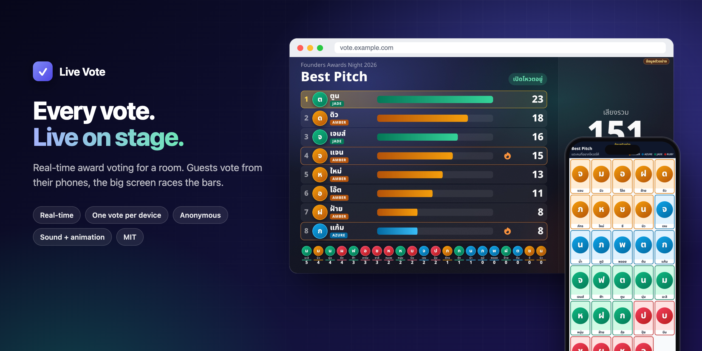
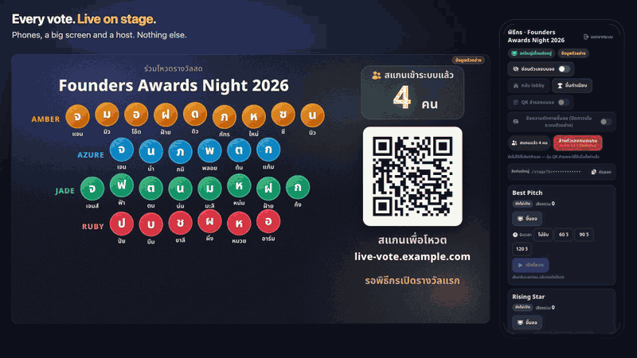
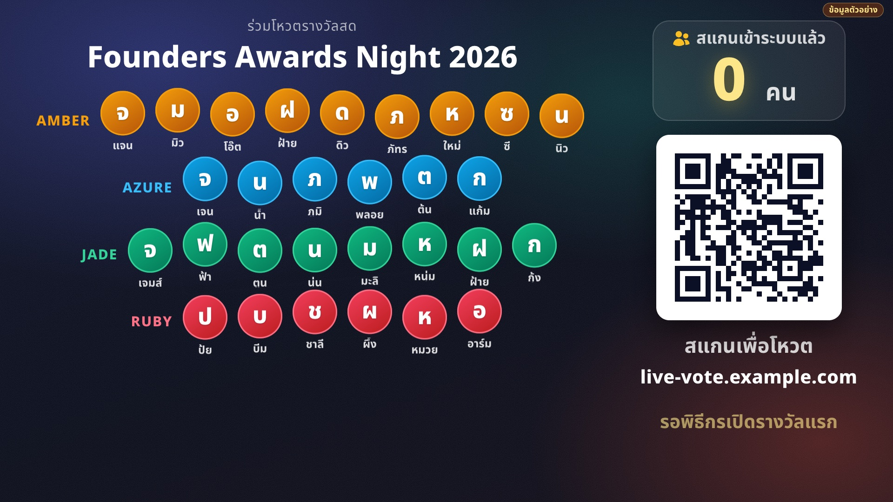
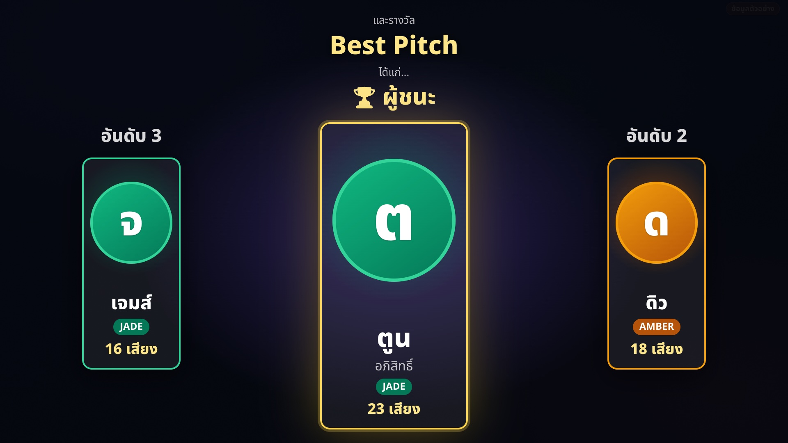
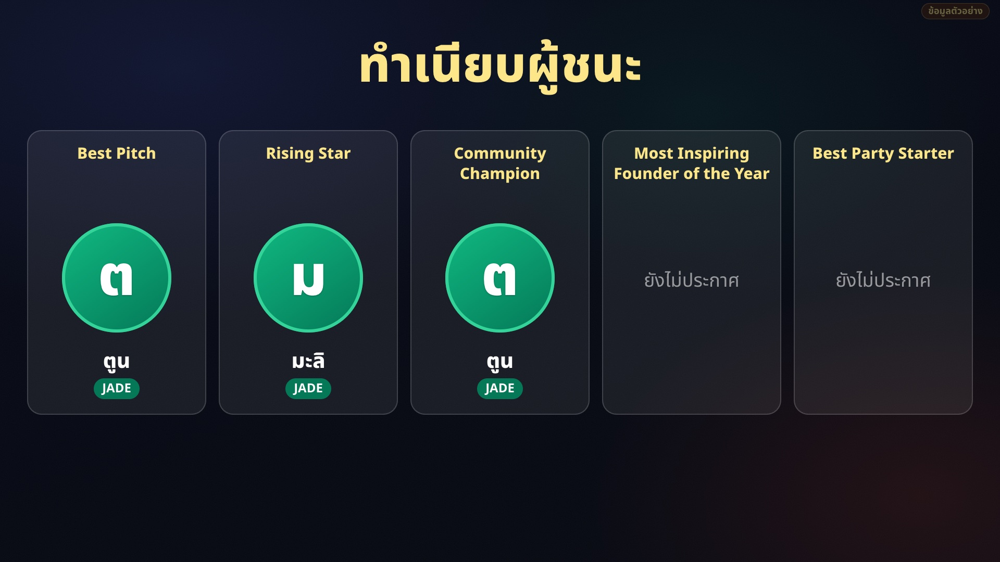
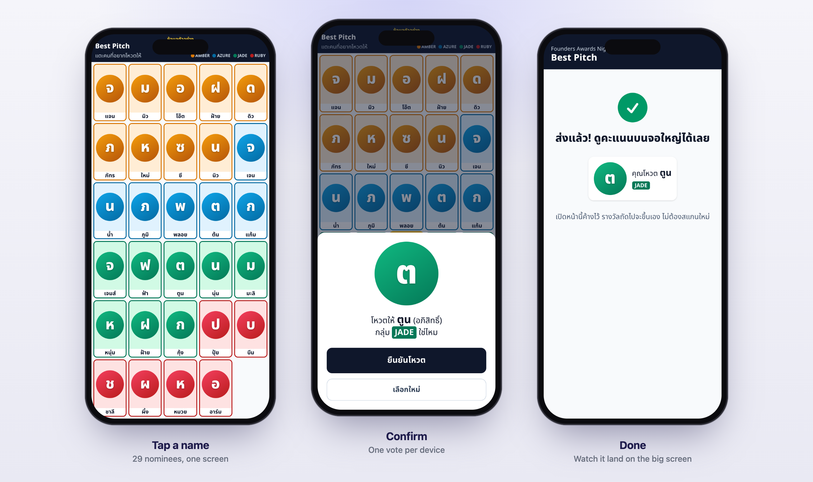
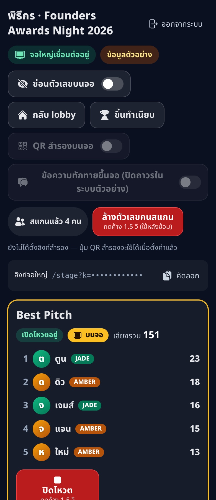

<div align="center">



# Live Vote

**Live award voting for a room.** Guests scan a QR code and vote from their phones. The big screen races the bars in real time, the host runs the show from their own phone, and the winners are announced with a podium.


**[▶ Try the live demo](https://live-vote-demo.vercel.app)** · host passcode `demo-host-2026` · [big screen](https://live-vote-demo.vercel.app/stage?k=demo-stage-2026)

[](https://vercel.com/new/clone?repository-url=https%3A%2F%2Fgithub.com%2Ftlejay%2Flive-vote&project-name=live-vote&repository-name=live-vote&env=DATABASE_URL,DATABASE_URL_UNPOOLED,ABLY_API_KEY,ADMIN_PASSCODE,ADMIN_SESSION_SECRET,DEVICE_SALT,STAGE_KEY,NEXT_PUBLIC_VOTE_URL)

[What you get](#-what-you-get) · [See it in action](#-see-it-in-action) · [Quick start](#-quick-start) · [Make it yours](#-make-it-yours) · [Configuration](#-configuration) · [How it works](#-how-it-works)

</div>

The demo runs in demo mode: every name is made up, the data resets every day, and no text typed by a visitor can reach the big screen.

## ✨ What you get

| Feature | What it does |
|---|---|
| 🏁 **Bar-chart race** | The big screen (built for 1920×1080) ranks the nominees live. Votes fly in as dots, lanes slide past each other, whoever is closing in on the lane above gets a flame. |
| 📱 **Phone voting page** | 29 nominees on one screen with no scrolling. Tap a name, confirm, done. Sending the same vote again (bad Wi-Fi, a retry) is never counted twice. |
| 🎛️ **Host page** | Open and close awards one at a time, set a 60 / 90 / 120 s timer or none, +30 s, hide the numbers, reveal the winner, show the hall of winners. Risky buttons need a 1.5 s hold, and the common ones can be undone. |
| 🏆 **Announcement scene** | Drumroll, then 3rd, 2nd and 1st on a podium with confetti. Equal scores go to whoever reached that score first, and the screen says so. |
| 🔒 **Anonymous, one vote per device** | A device gets one vote per award, enforced in Postgres. The database holds "this device voted" and, separately, "this nominee has N votes". There is no table that links the two. |
| 🔊 **Sound** | Vote ticks, overtakes, a new leader, countdown, gong, drumroll, applause, plus two looping music beds. All CC0. The start button on the stage unlocks browser audio. |
| 📡 **Built for bad Wi-Fi** | Phones keep working through dropped sockets, sleep and retries. The stage reconnects by itself and pulls the latest tally instead of freezing on old numbers. |
| 👋 **Lobby extras** | A scan counter ("scanned N people") and short hellos from phones that float up on the big screen (profanity-filtered, never stored). The host can switch them off. |
| 🧪 **Demo mode** | `DEMO_MODE=1` marks every screen "sample data", keeps greetings off for good and enables a daily reset cron. |

## 🎬 See it in action

<p align="center"></p>

The host opens an award from their phone, a guest taps a name and confirms, and the bars race as the rest of the room votes.

| Lobby | Reveal | Hall of winners |
|---|---|---|
|  |  |  |

## 📱 Built for the phone

<p align="center"></p>

- Nominees are coloured circles drawn with CSS, so the vote page downloads no images. First load measured with `pnpm bundle` is about **188 KB gzip** (HTML + JS + CSS; the Ably SDK loads lazily).
- Designed phone-first, with big tap targets. The host page is built for a phone too, and fine on a laptop.

<p align="center"></p>

> The screens are in **Thai**. All text lives in the components, so translating is a search-and-replace job; there is no i18n layer yet.

## 🚀 Quick start

You need Node 20+, [pnpm](https://pnpm.io), a Postgres database ([Neon](https://neon.tech) free tier works) and an [Ably](https://ably.com) app (free tier works).

```bash
pnpm install
cp .env.example .env.local     # fill in the values, see Configuration below
pnpm db:migrate                # create the tables and functions
pnpm db:seed                   # 5 awards, 29 nominees, 145 tally rows
pnpm dev                       # http://localhost:3000
```

| Open | What it is |
|---|---|
| `/` | the phone voting page (what the QR code points to) |
| `/stage?k=<STAGE_KEY>` | the big screen. Press "เริ่มงาน" once: it unlocks sound, goes full screen and keeps the display awake |
| `/admin` | the host page. Sign in with `ADMIN_PASSCODE` |

Open an award from `/admin`, vote from a phone (or several browsers) and watch `/stage`.

### Deploy

Push to GitHub and import into [Vercel](https://vercel.com) (or use the button above), set the environment variables, then run `pnpm db:migrate && pnpm db:seed` once against your production database. Set `NEXT_PUBLIC_VOTE_URL` to your public address so the QR code points to it. Check a deployment with `pnpm smoke https://your-app.example.com` (read-only).

## 🎨 Make it yours

| Change | Where |
|---|---|
| Event name | `EVENT_TITLE` in `src/data/nominees.ts`, then `pnpm db:seed --refresh-names` |
| Award names | `src/data/awards.ts` (or rename them live from the host page) |
| Nominees | `src/data/nominees.ts`: nickname, first name and one of four groups, 29 of them. Groups can be any size (the demo uses 9 / 6 / 8 / 6); the lobby fits up to 9 per row |
| Group names and colours | The four group names appear in `src/data/nominees.ts`, `src/components/avatar.tsx`, `src/components/group.ts` + `src/app/globals.css`, `src/app/stage/palette.ts`, `src/app/stage/bubble-style.ts`, `src/app/admin/admin.module.css`, and the check constraint in `drizzle/0000_init.sql` and `src/db/schema.ts`. Search for one of them and change all |
| Serve under a sub-path | `NEXT_PUBLIC_BASE_PATH=/vote` at build time |
| Sounds | `public/audio/` is rebuilt from your own CC0 sources with `pnpm audio <folder>` (needs ffmpeg) |

The number of nominees (29) and awards (5) is wired into the layouts and the database, so a different count means touching the stage geometry (`src/app/stage/geometry.ts`, `lobby-layout.ts`) and the seed.

## ⚙️ Configuration

| Variable | Required | What it is |
|---|---|---|
| `DATABASE_URL` | yes | Postgres, pooled connection (the app) |
| `DATABASE_URL_UNPOOLED` | yes | Postgres, direct connection (migrations, seed, scripts) |
| `ABLY_API_KEY` | yes | Server only. Browsers get role-scoped tokens from `/api/realtime/token`; a phone token cannot read the tally channel |
| `ADMIN_PASSCODE` | yes | Host page passcode |
| `ADMIN_SESSION_SECRET` | yes | Signs the host session cookie (`openssl rand -hex 32`) |
| `DEVICE_SALT` | yes | HMAC salt for device ids (`openssl rand -hex 32`). Changing it lets every phone vote again |
| `STAGE_KEY` | yes | The key in the stage URL (`openssl rand -hex 12`) |
| `NEXT_PUBLIC_VOTE_URL` | for the QR | Address the stage QR code points to (default `http://localhost:3000` + base path) |
| `NEXT_PUBLIC_VOTE_URL_FALLBACK` | no | A second address the host can switch the QR to |
| `NEXT_PUBLIC_BASE_PATH` | no | Sub-path the app is served under. Empty by default |
| `DEMO_MODE` | no | `1` turns on [demo mode](#demo-mode) |
| `CRON_SECRET` | demo only | Bearer token for the daily reset cron |
| `TEST_DB_HOST` | tests | First label of your **test** database's hostname. Tests and DB-writing scripts refuse any other host |
| `CHROME_PATH`, `E2E_OUT`, `E2E_SCREEN_OFF_MS`, `VERCEL_AUTOMATION_BYPASS_SECRET` | no | Options for the e2e, load and smoke scripts. See `.env.example` |

### Demo mode

With `DEMO_MODE=1`:

- the stage, vote page and host page show a small "ข้อมูลตัวอย่าง" (sample data) tag;
- lobby greetings are off for good, on the server and in the UI, and so is renaming awards (the pencil button is hidden and the server refuses the action), because anyone can open a public demo and the text would land on the big screen;
- `GET /api/cron/reset-demo` (with `Authorization: Bearer $CRON_SECRET`, which Vercel sends for you) puts every award back to empty and pending with its seeded name, returns the stage to the lobby and zeroes the scan counter. `vercel.json` runs it daily. Without demo mode the route answers 404 and does nothing.

## 🧠 How it works

```
phone ──POST /api/vote──▶ Next.js route ──cast_vote()──▶ Postgres   (ballot box: counts + dedupe)
                                │                                      
                                └── publish tally ──▶ Ably ──▶ stage  (loudspeaker: the stage listens)
phone ◀── statuses only ────────────────────────────── Ably            (no counts ever reach a phone)
host ──POST /api/admin/action──▶ Postgres function (state machine) ──▶ Ably
```

- **Postgres is the source of truth.** Counting, the one-vote rule and every award state change run inside PL/pgSQL functions (`drizzle/*.sql`), one round trip each. Ably only announces; if a message is lost, the stage re-reads the snapshot every 15 s and on reconnect.
- **One vote per device**: a random id in an httpOnly cookie plus a localStorage copy; the server stores only an HMAC of it. Clearing browser data or using a private window gives a new device, so this suits a friendly room, not a high-stakes election.
- **Realtime stays in two places**: screens talk to it only through `src/lib/live/` (browser side) and `src/lib/server/ably.ts` (publishing), so swapping Ably for another provider does not touch any page.
- **The stage** is drawn once on a fixed 1920×1080 canvas that is scaled to the window; its animation is built on `transform` and `opacity`.

## 🧰 Scripts

| Command | What it does |
|---|---|
| `pnpm dev` / `build` / `start` | Next.js |
| `pnpm lint`, `pnpm exec tsc --noEmit` | Static checks |
| `pnpm test` | Vitest: unit tests plus tests against the **test** database and Ably |
| `pnpm db:migrate`, `db:seed` | Apply migrations; seed awards, nominees and tallies (`--refresh-names` also resets award and event names) |
| `pnpm award open 1 90` | Dev stand-in for the host page (`close`, `reveal`, `reset`, `current`, `hide`, `status`) |
| `pnpm e2e`, `e2e:stage`, `e2e:admin`, `e2e:phone` | Headless-Chrome end-to-end runs against a running server (default ports 3155 / 3156 / 3157). Test database only |
| `pnpm load` | Load test over HTTP + Ably, like real phones |
| `pnpm latency`, `pnpm bundle`, `pnpm smoke` | Vote-to-screen latency, first-load weight, read-only post-deploy check |
| `pnpm audio` | Rebuild `public/audio/` from CC0 sources |

## 🔐 Security and privacy

- `DATABASE_URL`, `ABLY_API_KEY` and the secrets are read on the server only. `pnpm smoke` greps the built pages and JS chunks for secret patterns.
- The host page needs `ADMIN_PASSCODE`; guessing is throttled per browser, never per IP, so a guest on the venue Wi-Fi cannot lock the host out.
- Nobody can see who voted for whom: the ballot table has no nominee and no time, the tally table has no device.
- Greetings are filtered, rate-limited, and never stored or logged.
- Errors shown to people are plain Thai sentences that say what to do next, never raw system text.

## 🗂️ Layout

```
src/app/            vote page (/), stage, admin, API routes
src/app/stage/      big-screen scenes, race geometry, sound engine
src/components/     avatar (coloured circle + initial), group styles
src/data/           nominees and awards
src/lib/            server helpers, realtime interface, shared types
drizzle/            migrations and the PL/pgSQL functions
scripts/            migrate, seed, e2e, load, smoke, audio
tests/              vitest
```

## Contributing

See [CONTRIBUTING.md](CONTRIBUTING.md).

## License

[MIT](LICENSE) © Tle Jakapong. Sound effects and music are CC0, with sources in [`public/audio/CREDITS.md`](public/audio/CREDITS.md).

<div align="center">

If this saves your next event, a ⭐ helps others find it.

</div>
